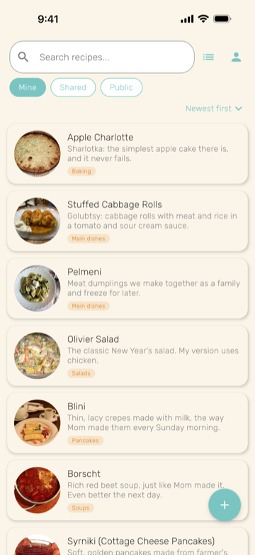
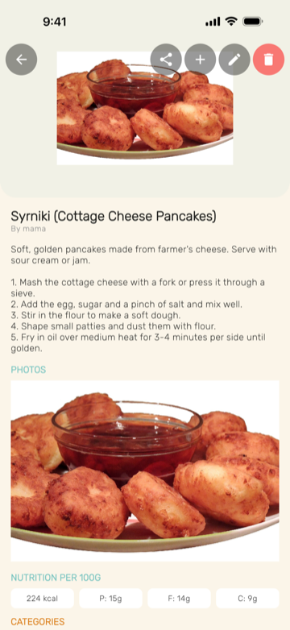
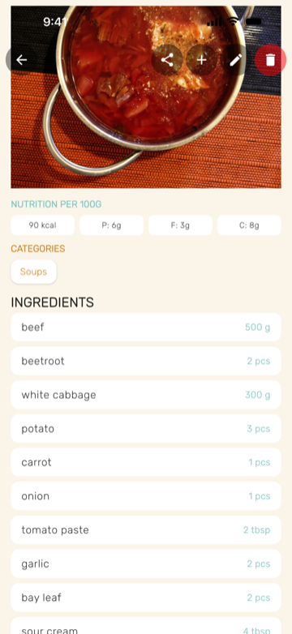
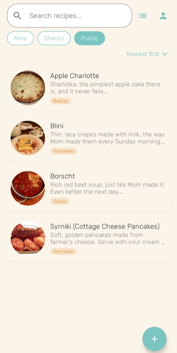
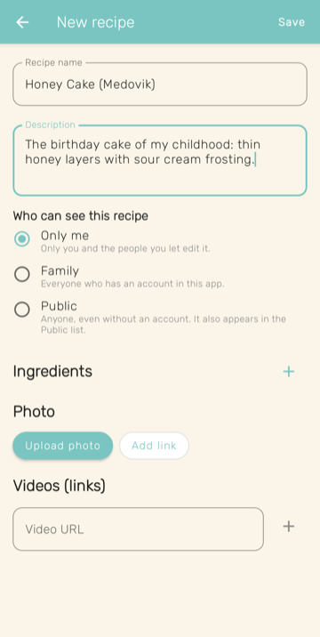
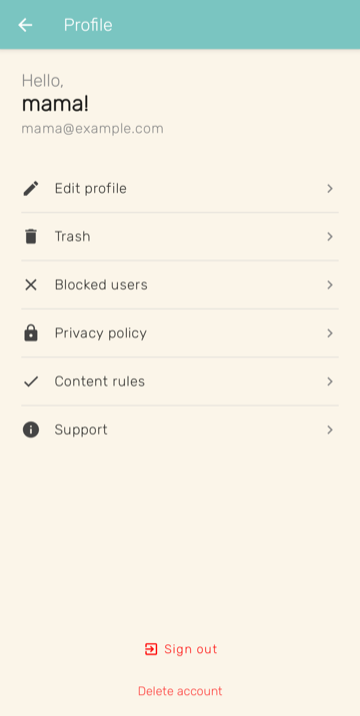
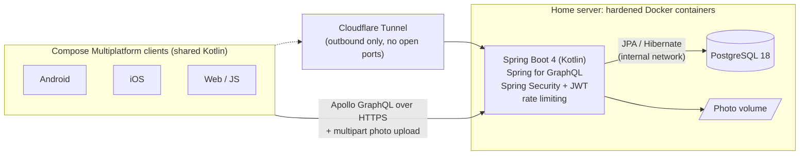

# Family Recipes

A private recipe book for my family: one Kotlin codebase for Android, iOS and the web, backed by
a Spring Boot GraphQL API and PostgreSQL. It started as a way to digitise my mom's handwritten
recipes and grew into a small multi-user app.

The app is in real use: it is published on the App Store as an Unlisted app and on Google Play in
a closed test, for family and friends only. This repository is a cleaned public copy of it with
local demo data in place of the family's recipes.

<p>
  
  
  
</p>
<p>
  
  
  
</p>

## Architecture



In production the API and the web build run on a small home server. A Cloudflare Tunnel connects
them to the internet, so the router has no open ports. Each container runs as a non-root user
with a read-only filesystem, and the database sits on an internal Docker network that only the
backend can reach.

## Stack

| Layer | Technology |
|---|---|
| Clients | Kotlin Multiplatform, Compose Multiplatform (Android, iOS, Web/JS), Apollo Kotlin 3, Ktor, Coil 3 |
| API | Spring Boot 4, Kotlin, Spring for GraphQL, Spring Security, JWT (jjwt), Spring Data JPA / Hibernate |
| Database | PostgreSQL 18 |
| Tests | JUnit 5, MockMvc, Testcontainers (backend); kotlin.test (shared client code) |
| Ops | Docker Compose, multi-stage image, Cloudflare Tunnel |

## By the numbers

- **50 GraphQL operations** on the server: 14 queries and 36 mutations (`schema.graphqls`)
- **48 client operations** in the app (`shared/src/commonMain/graphql`)
- **19 database tables**, including join and collection tables
- **372 backend tests** (unit and MockMvc integration tests against real Postgres via Testcontainers)
- **90 client tests** in the shared Kotlin module
- **2 UI languages**: English and Russian

## Features

- **Recipes** with ingredients, units and quantities, categories, step-by-step text, photos and
  video links. Search by name, ingredient or category.
- **Nutrition**: calories, protein, fat and carbs per 100 g, computed from the ingredients
  (including unit-to-gram conversions for cups, spoons and pieces).
- **Visibility**: each recipe is *Only me*, *Family* or *Public*.
- **Sharing and co-editing**: share a recipe with specific people and let them edit it; copy
  someone else's recipe into your own book.
- **Photos**: upload from the phone or link from the web. Uploads are re-encoded on the server,
  which strips EXIF metadata such as GPS position.
- **Notes** on any recipe you can read.
- **Trash** with restore and permanent delete.
- **User-generated content safeguards**: report a recipe or a user, block a user, a blocked-words
  check before anything becomes visible to others, and admin unpublish.
- **Accounts**: sign-up with an invite code, password reset by email, change password or
  username, and **account deletion** from within the app.
- **Localisation**: English and Russian, chosen per user.

## Security highlights

- **JWT auth** with BCrypt password hashes, token revocation on logout and password change.
- **Rate limits** on login, sign-up, password reset, account deletion, photo uploads and
  reports. Limits are keyed on the client IP from Cloudflare's `CF-Connecting-IP`, not on
  `X-Forwarded-For`, which a client can spoof.
- **GraphQL limits**: maximum query depth and complexity. Introspection and GraphiQL are off in
  production.
- **Authorisation in one place** (`AdminService`): every read and write checks visibility,
  sharing, blocks and suspension.
- **Hardened containers**: non-root uid, read-only root filesystem, `cap_drop: ALL`,
  `no-new-privileges`, memory and PID limits. Postgres is on an internal network with no
  published port.
- **Secrets via environment variables** only. Nothing secret is in the repository.

## Run locally

Requirements: Docker with Compose. The first build compiles the backend inside Docker and takes
a few minutes.

```bash
docker compose up --build
```

This starts PostgreSQL, preloaded with the demo data from `demo/`, and the API on
**http://127.0.0.1:8080** (bound to localhost only).

| | |
|---|---|
| Demo login | username `demo`, password `demo-password-123` |
| Invite code (to create new accounts) | `demo-invite` |
| GraphQL endpoint | `POST http://127.0.0.1:8080/graphql` |
| Health | `GET http://127.0.0.1:8080/actuator/health` |

Every setting has a local default in `compose.yaml`. To override one, copy `.env.example` to
`.env`. No mail server is needed: password-reset emails fail quietly and are logged. To reset the
demo data, run `docker compose down -v`.

Quick check from the command line:

```bash
TOKEN=$(curl -s http://127.0.0.1:8080/graphql -H 'Content-Type: application/json' \
  -d '{"query":"mutation { login(username: \"demo\", password: \"demo-password-123\") }"}' \
  | sed -E 's/.*"login":"([^"]+)".*/\1/')
curl -s http://127.0.0.1:8080/graphql -H 'Content-Type: application/json' \
  -H "Authorization: Bearer $TOKEN" -d '{"query":"{ recipes { name visibility photoUrls } }"}'
```

### Clients

Debug builds read the API host from `app/gradle.properties` (`recipe.serverHost.debug`,
default `localhost:8080`) and use plain HTTP.

- **Web**: `cd app && ./gradlew :webApp:jsBrowserRun` and open http://localhost:8081.
- **Android emulator**: the emulator reaches your machine as `10.0.2.2`:
  `cd app && ./gradlew :androidApp:installDebug -Precipe.serverHost.debug=10.0.2.2:8080`.
  Android Studio needs `app/local.properties` with `sdk.dir=...`.
- **iOS Simulator**: run `pod install` in `app/iosApp`, open `iosApp.xcworkspace` and set your
  own team in `Configuration/Config.xcconfig`. The simulator reaches the API at `localhost:8080`.

Release builds require a public HTTPS host (`-Precipe.serverHost.release=api.example.com`). The
deep-link domain `recipes.example.com` is a placeholder.

### Tests

```bash
cd backend && ./gradlew build                    # needs a running Docker engine (Testcontainers)
cd app && ./gradlew :shared:allTests :androidApp:assembleDebug
```

## Project structure

```
family-recipes/
├── compose.yaml          # local stack: postgres + backend + demo data
├── .env.example          # optional local overrides
├── backend/              # Spring Boot GraphQL API (Kotlin)
│   ├── Dockerfile        # multi-stage: Gradle build -> JRE runtime, non-root
│   └── src/main/
│       ├── kotlin/…      # recipe, user, security, moderation, photo, nutrition, trash, …
│       └── resources/    # application*.yaml, graphql/schema.graphqls, reference seed SQL
├── app/                  # Kotlin Multiplatform client
│   ├── shared/           # Compose UI, Apollo client, repositories, navigation (all platforms)
│   ├── androidApp/       # Android entry point
│   ├── iosApp/           # iOS entry point (SwiftUI host, CocoaPods)
│   └── webApp/           # Web entry point + static pages (privacy, terms, support)
├── demo/
│   ├── initdb/01-demo.sql  # schema + demo user + 7 English recipes
│   ├── uploads/            # the recipe photos
│   └── CREDITS.md          # photo authors and licenses (Wikimedia Commons)
└── docs/screenshots/
```

## Credits

The demo recipe photos, which also appear in the screenshots, come from Wikimedia Commons under
CC BY / CC BY-SA licenses. Authors and licenses are listed in [demo/CREDITS.md](demo/CREDITS.md).
`app/LICENSE.txt` is the Apache 2.0 license inherited from the JetBrains Kotlin Multiplatform
template the client started from.
